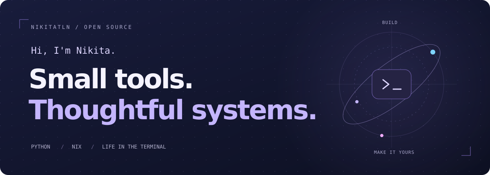
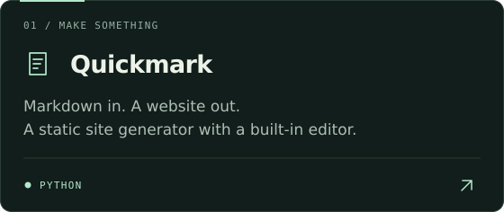
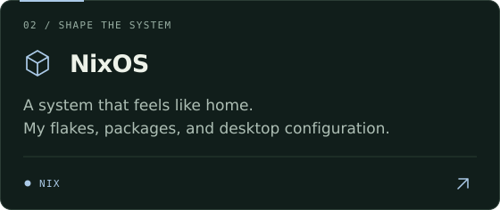
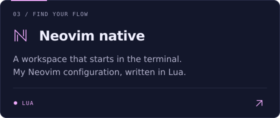
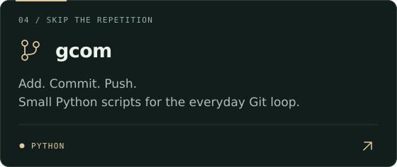
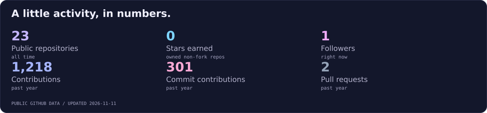
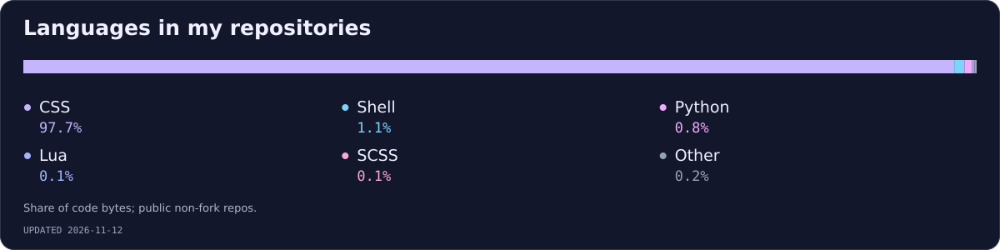
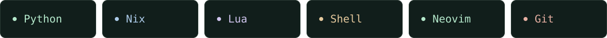

  

  I build Python tools and shape my development environment with <strong>Nix, Neovim, and shell scripts.</strong> 
  This is my corner of the internet for useful projects and a setup that feels like home.

  <a href="https://github.com/NikitaTLN?tab=repositories">Explore my repositories ↗</a>
  &nbsp; · &nbsp;
  <a href="https://github.com/NikitaTLN/quickmark">Meet Quickmark ↗</a>

 

### A few things I've made

<table>
  <tr>
    <td width="50%"><a href="https://github.com/NikitaTLN/quickmark"><picture><source media="(max-width: 600px)" srcset="./assets/quickmark-mobile.svg" /></picture></a></td>
    <td width="50%"><a href="https://github.com/NikitaTLN/nixos"><picture><source media="(max-width: 600px)" srcset="./assets/nixos-mobile.svg" /></picture></a></td>
  </tr>
  <tr>
    <td width="50%"><a href="https://github.com/NikitaTLN/Neovim-native"><picture><source media="(max-width: 600px)" srcset="./assets/neovim-mobile.svg" /></picture></a></td>
    <td width="50%"><a href="https://github.com/NikitaTLN/gcom"><picture><source media="(max-width: 600px)" srcset="./assets/gcom-mobile.svg" /></picture></a></td>
  </tr>
</table>

 

### On GitHub

  <a href="https://github.com/NikitaTLN?tab=overview"><picture><source media="(max-width: 600px)" srcset="./assets/stats-mobile.svg" /></picture></a>

  <picture><source media="(max-width: 600px)" srcset="./assets/languages-mobile.svg" /></picture>

Updated daily from GitHub. Language shares measure repository code, not proficiency.

 

### My kind of toolbox

  <picture><source media="(max-width: 600px)" srcset="./assets/toolbox-mobile.svg" /></picture>

Python for the useful little things. Nix for the system. Neovim for the space in between.

 

---

Built with curiosity. Kept simple. &nbsp; / &nbsp; <a href="https://github.com/NikitaTLN">@NikitaTLN</a>

